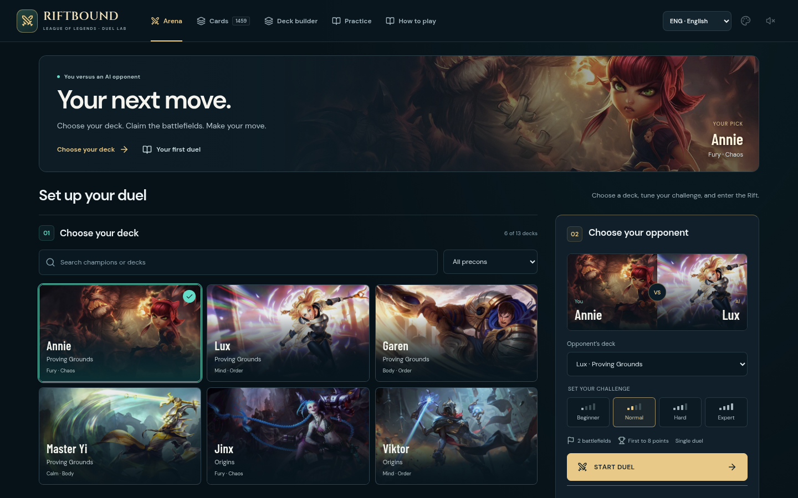
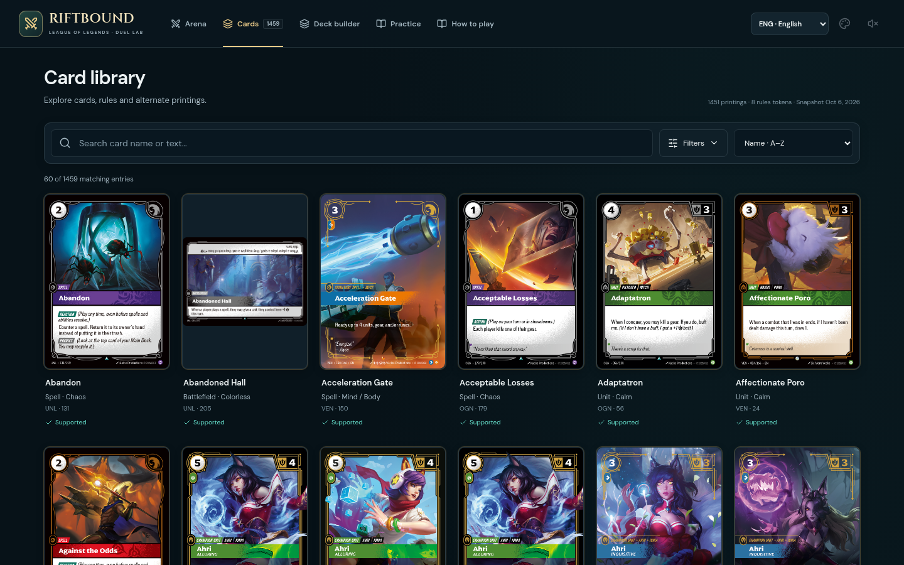
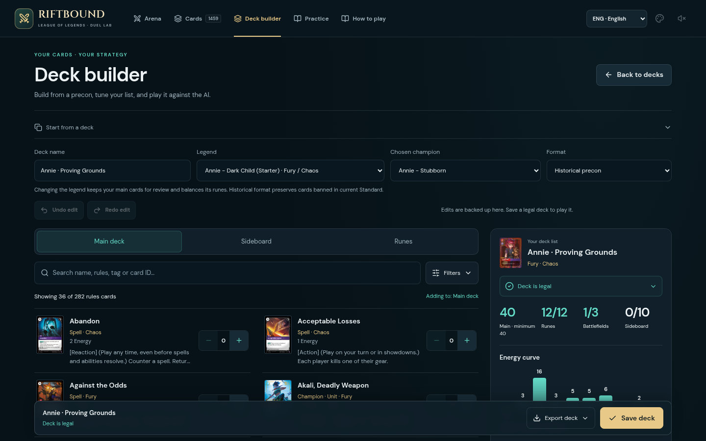

# Design refinement

This pass refines the dark interface introduced in [UI-UX-UPGRADE.md](UI-UX-UPGRADE.md). The aim is to bring useful content into view sooner, reduce repeated framing and keep common actions available while browsing. The match table's geometry and large image-only card preview remain unchanged.

## Captured flow and design decisions

1. **Choose a deck and start a duel — clearer and quicker to reach.** The previous hero and repeated introduction pushed the desktop launch action below the initial view. The shorter hero now uses the selected champion's artwork and identity. The deck gallery sits directly on the page, while opponent setup retains a distinct panel. On a 1366 × 768 laptop, the main launch button is visible without scrolling. Phones, landscape touch layouts and short desktop windows have a persistent matchup/launch dock.

   

2. **Browse the card library — more artwork, persistent discovery controls.** The prior large heading, filter box and separate results toolbar placed the first cards at y624 on desktop and y680 on mobile. A compact heading and a single sticky search/filter/sort toolbar bring them to approximately y309 and y368. Filters open in a bounded panel. Individual chips remove one refinement; clearing the query preserves other filters. Keyboard navigation closes the nonmodal filter panel when leaving it, and chip removal keeps a logical focus target.

   

3. **Build and save a deck — easier to scan and edit.** Card discovery uses aligned thumbnail, name, metadata and quantity columns, with shorter rules excerpts and quieter row separators. A stable footer keeps Save prominent and groups text/file exports behind one control. Delete moves into deck settings. Empty results explain when the addable-cards filter is hiding cards because runes or the sideboard are full. Filter chips and separate search clearing preserve the rest of the query.

   

## Preserved behavior

- Deck validation, exact quantities, Undo/Redo, local drafts, import/export, language switching and session persistence retain their existing rules.
- The table grid, bases, rune/hand positions, card dimensions and responsive match layouts are unchanged.
- Card hover remains a large image without a repeated description or statistics panel. Existing card backs and appearance preferences remain available.
- Shared page-width/gutter tokens align the three screens. Mobile navigation targets are at least 44px high.

## Validation

Production build `2332509d3cf0` passed TypeScript and Vite builds, focused catalog/deck/history/setup/localization tests, formatting and diff checks. Chromium checks against the production preview covered:

- Four match-table viewports compared with the preceding release, with geometry unchanged within 1px and desktop hover showing one 360px artwork image.
- Seven lobby viewport sizes, including 320px phones, short desktops and landscape touch screens, with reachable launch actions and keyboard navigation and no horizontal overflow.
- Six lobby size/language scenarios and 21 support checks across 1440 × 900, 390 × 844 and 320 × 568: filters, focus recovery, quantity editing, Undo, text/file export, save/import round trips and all six training lessons. No page errors were observed.
- All 86 application-shell assets verified by HTTP response and hash, service-worker installation and offline reloads, appearance persistence, all four card-back options, and all 38 selected-deck images downloaded successfully for offline use.

The screenshots above were captured from this production build after the visible artwork loaded.

## Evidence limits

The screenshots demonstrate the named screen states. Keyboard and browser checks cover the tested flows and viewports; they do not establish complete accessibility conformance. Card names and printed rules retain their original language, while new interface copy is available in English, Serbian and Italian.
