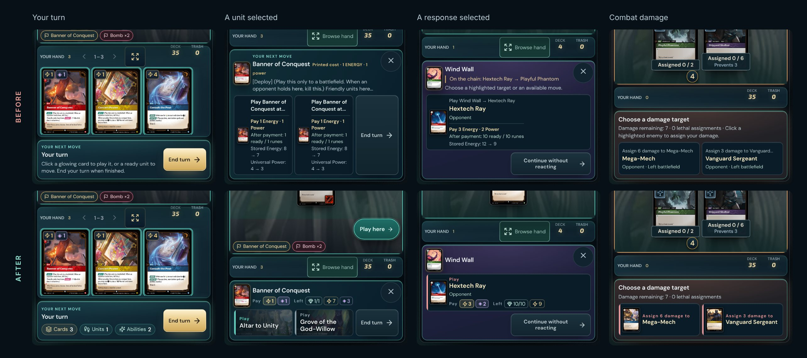

# Dock commands that are drawn — 17 November 2026

On a phone the dock was mostly text. With a unit selected, each option repeated four receipt sentences in a column 125 px wide; with nothing selected, the dock was one instruction. The dock now draws its commands: chips for a cost, the place or the target for an option, and counts for what can be done. Every screen uses the same markup.

## What changed

- **A receipt is chips.** "Pay 1 Energy · 1 Power", "After payment: 1 ready / 1 runes", "Stored Energy: 8 → 7" and "Universal Power: 4 → 3" are now two groups: **Pay** ⚡1 ◈1 and **Left** 1/1 ⚡7 ◈3. The bolt and the diamond are the ones the cards carry; the gem counts ready runes among those that remain.
- **A shared receipt is shown once.** When every listed option costs the same, the receipt sits under the card's name. The printed cost appears beside it only when it is a different amount.
- **A place is drawn as the place.** Playing or moving the card in the heading to a base or a battlefield shows the battlefield's art and name ("Altar to Unity") under the verb ("Play", "Hide"). The tile's edge has the colour of whoever controls the place.
- **A target is drawn as the target.** The tile shows the target's art and name under the verb of its label ("Assign 6 damage to"), and its edge has the owner's colour. In combat the place is not repeated on each tile: every target is at the battlefield of the fight.
- **The idle dock counts.** With nothing selected, the sentence "Click a glowing card to play it, or a ready unit to move. End your turn when finished." gives way to counts by kind: Cards 3, Units 1, Abilities 2. When nothing can be played, the dock says so.
- **Listed options replace instructions.** While options are listed, the general instruction, the card's text, the small heading above the name and the reminder of the chain are not drawn. An instruction about this card's situation stays: a Hidden play, a blocked card, the count of a selection, the damage that remains.

## How it is built

The previous pass made the desktop dock fit by hiding parts of an option per screen size in a layout sheet, while the phone kept all of them. That is now decided once, in the component:

- `MatchControls.tsx` decides what an option is (a place, a target, or plain) and what the heading shows. `DecisionPayment.tsx` draws a receipt.
- `src/dock-commands.css` draws the inside of a command for every layout. The layout sheets still size and place the tiles.
- `src/native-table.css` loses 124 lines of rules that hid parts of an option on particular screen sizes.

Text that is no longer drawn stays in the markup, marked `read-text`: the receipt's sentences, the instruction, the printed cost. Assistive technology reads it, and the existing tests and browser checks find it. An option's accessible name is still its full label ("Play Playful Phantom at your base"), and an option that shares a receipt is described by it.

## Measured

A 390 × 844 phone, in English, before (`bb8e4eb`) and after. "Drawn characters" counts the text that is drawn inside the dock.

| State                            | Dock height (px) | Drawn characters | Pictures and icons |
| -------------------------------- | ---------------: | ---------------: | -----------------: |
| Your turn, nothing selected      |          84 → 84 |         117 → 53 |              1 → 4 |
| A unit selected (two places)     |        277 → 128 |         480 → 87 |              5 → 8 |
| A Hidden card selected           |        216 → 181 |        231 → 138 |              3 → 4 |
| A response selected (one target) |        253 → 204 |         246 → 73 |              4 → 7 |
| Combat damage (two targets)      |        146 → 131 |        258 → 124 |              0 → 2 |
| A spell selected (two targets)   |        243 → 204 |         217 → 80 |              6 → 9 |
| Movement to confirm              |        163 → 146 |        185 → 143 |              1 → 2 |

A lower dock leaves more of the board in view.

On desktop, the [2,070 dock measurements](PREMIUM-FINISH.md#measured) were repeated. No content is taller than the dock, no control lies outside it, none overlap and no heading is cut. The list of options needs scrolling in 268 of the 918 measurements that list options (274 before).

## Validation

<!-- validation:start -->

- **Unit tests.** Code as of commit `396ecb3`; the commit after it changes one style rule. The full run outside the precon matrix has **3,028 tests in 156 files**: 3,027 passed. One simulation test (a complete Vex game) reached its 60-second limit while screenshots were being captured on the same machine; its file then passed on its own, 15 of 15. The engine is untouched, so the precon matrix was not repeated.
- **New tests.** Five in `tests/match-clarity.test.ts`: the shared receipt is rendered once and still describes each option, a play to a place is drawn as the place and keeps its full label, a single option keeps its receipt without a second cost beside it, a target option is named by its target, and the idle dock counts what can be done.
- **Browser checks.** The 22 scripts ran against the new code in headless Chromium. Each has the same outcome as on `bb8e4eb`, which the [earlier table](PREMIUM-FINISH.md#browser-checks-before-and-after) lists. The first run of `native-table-check` found one regression, described below.
- **Reachable controls.** Every visible control in the dock is the element under its own centre, in six states at 1920 × 1080, 1440 × 900, 1366 × 768, 1280 × 600, 390 × 844 and 844 × 390.
- **Production build.** A duel started from the lobby at 390 × 844, 320 × 568 and 1440 × 900 reaches the player's turn and a selected card with no page error, no control covered and no page overflow.
- TypeScript, the production build and catalog consistency pass.

### Found while checking

Text that is read but not drawn needs a positioned parent, and the text block beside the card art in the desktop heading became one. It then painted over the art, so a click on the art no longer opened the card. `native-table-check` reported it as "Control is covered or clipped"; the art now stacks above the text block.

<!-- validation:end -->

## Evidence limits

Checked in headless Chromium at 390 × 844, 320 × 568, 844 × 390 and 768 × 1024, on the compact desktop layout at 1280 × 600 and on the desktop table from 1100 × 650 to 1920 × 1080, in English and Serbian. No physical phone, Safari or Firefox was used. The counts of what can be done come from the player's own legal actions, so they show nothing about the opponent's hand.
