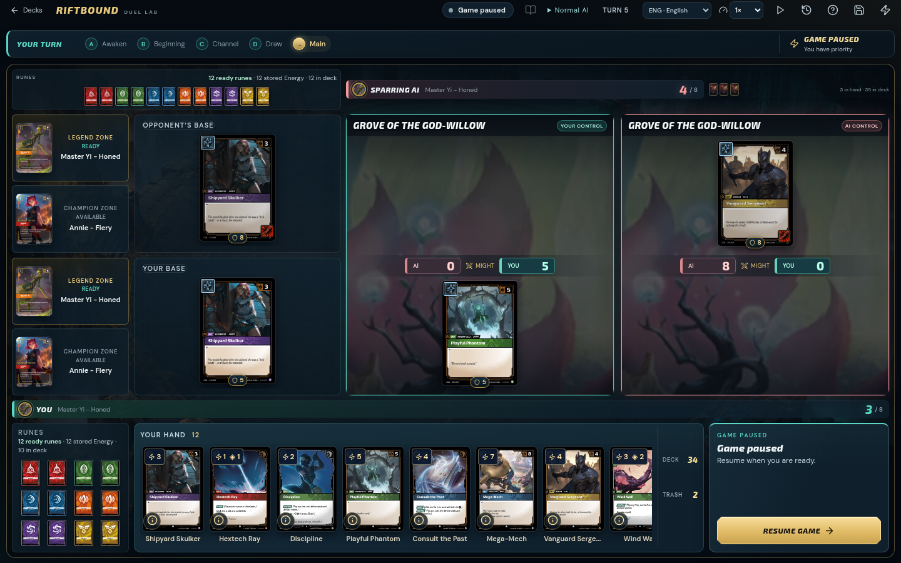

# Native desktop table — 16 October 2026

At desktop sizes from 1100 × 650, both bases now sit beside two tall
battlefields. Legend and Champion slots occupy the left rail. Your runes sit
at the bottom left beside a persistent hand; the decision dock sits at the
bottom right. Selecting a unit or reaction no longer collapses the desktop
hand. Crowded bases scroll horizontally at their normal card size. Target
choices stack vertically in the scrollable decision dock.

The new geometry lives in `src/native-table.css`. Opening-hand selection keeps
its dedicated layout, and smaller screens retain the existing mobile/tablet
zone view. At 1440 × 900, the populated main-phase fixture's base cards grow
from approximately 39 to 170 pixels high. At 1920 × 1080 they are 216 pixels
high; the short 1100 × 650 layout retains approximately 103-pixel cards.

Hover previews are capped at 420 pixels wide and 440 pixels high, with smaller
art, type and shadows. Hand previews prefer the space above the hovered card.
Keyboard focus, Escape, playback suspension and the touch reading dialog
retain their existing behavior.



## Validation

- TypeScript and the production Vite/server build passed. The existing large
  bundle advisory remains.
- 110 tests passed across 11 presentation, action, Hidden, playback and
  exhaustion suites.
- `npm run cards:check` and `node scripts/check-regression-reports.mjs` passed.
- `scripts/native-table-check.mjs` passed all 15 browser scenarios at
  1440 × 900, 1920 × 1080 and 1100 × 650: actual movement, combat assignment,
  reaction targets, Hidden payment, crowded base access, stable hand geometry,
  compact previews and reachable controls. No viewport overflow or runtime
  JavaScript errors were observed.
- Chromium touch checks passed at 390 × 844 and 844 × 390: longpress opens
  details without playing a card; Browse hand retains all 12 cards and returns
  to the reading sheet after closing nested details. These are emulated
  viewport checks, not physical-device testing.

Run the desktop regression with a local Vite server and Playwright available:

```sh
node scripts/native-table-check.mjs
```

`PLAYWRIGHT_MODULE` can point to an installed Playwright module (or browser
launcher adapter), and `QA_OUTPUT` selects the local evidence directory.
