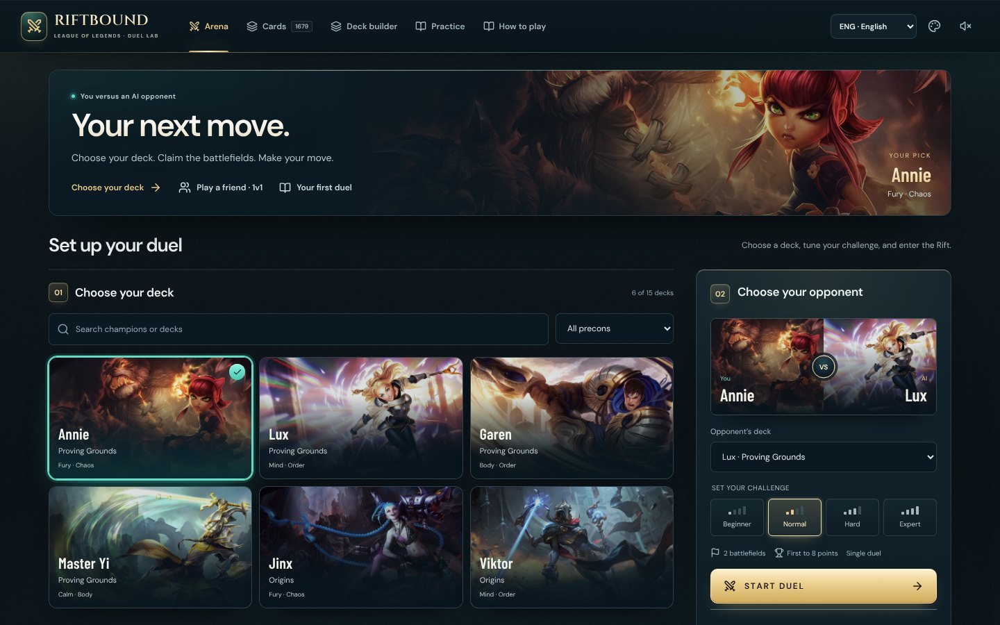
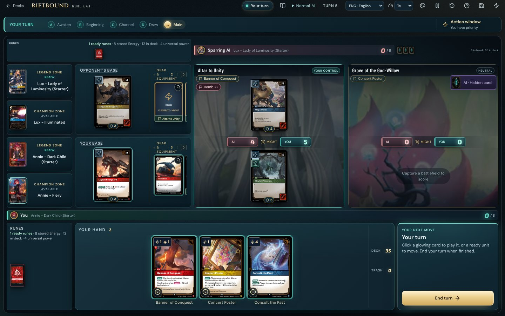
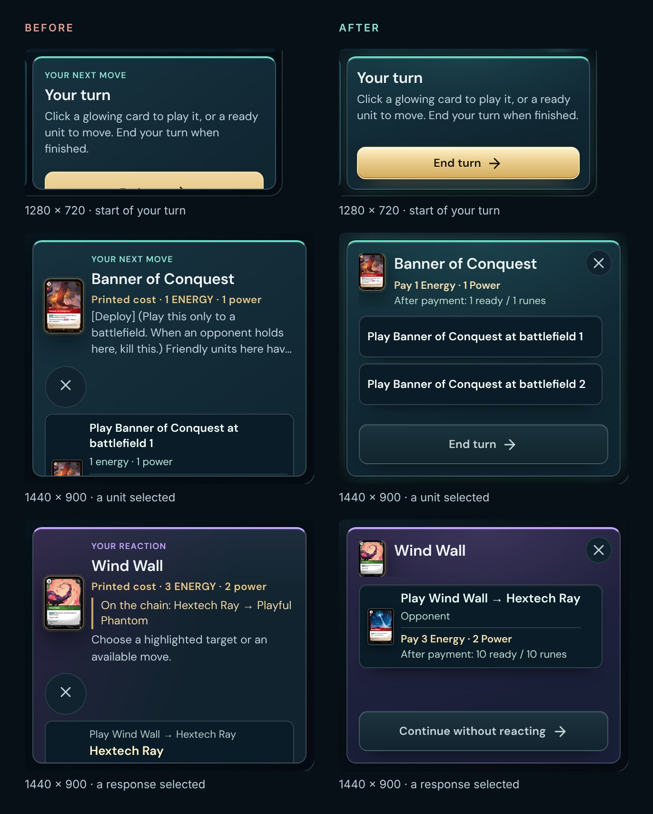
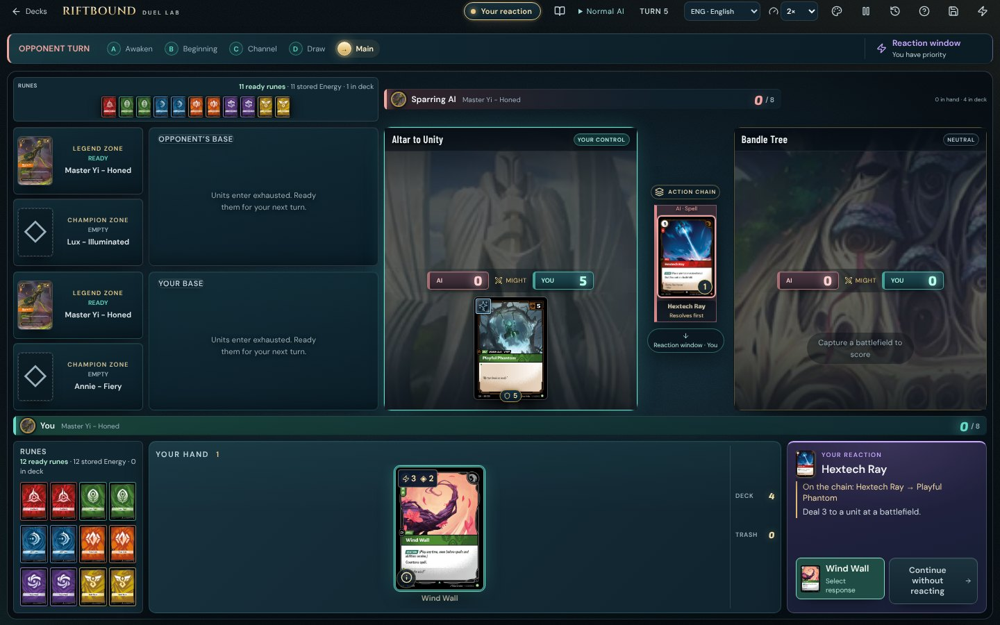
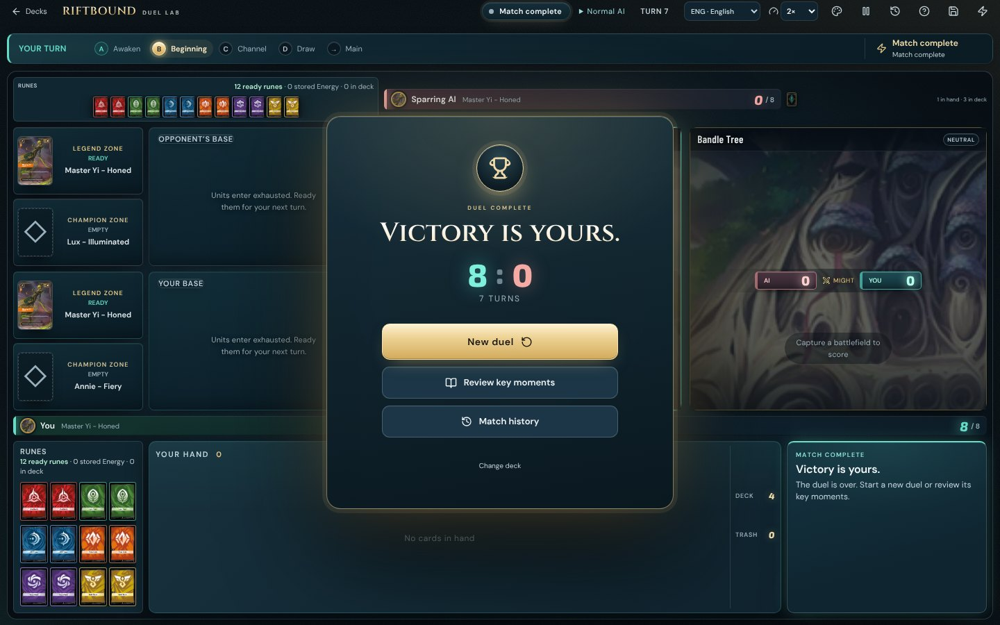

# Premium finish — 14 November 2026

This pass gives the whole app one finish: more light and depth, metal accents on the actions that matter, and a calmer loading and arrival of screens. It also fixes the layout and copy defects that an audit of every screen turned up. The largest was the command dock on desktop, which cut off its own buttons in most states. Zone positions and sizes on the match table are unchanged.

## Design decisions

1. **One stylesheet, loaded last, paint only.** `src/premium.css` owns surface light, shadows, borders, type detail and motion. It does not set a size, margin, grid or position of a zone; those stay in the layout sheets. The layout corrections below live in `src/native-table.css`.
2. **One primary action per screen.** Start duel, End turn, Save deck, Create room and the first button of the result panel use the same champagne metal, with a sheen on hover. Every secondary action is quiet glass.
3. **Depth instead of flat panels.** The page has a layered aurora and a fine film grain, which also removes banding from the dark gradients. Panels are lit from the top and cast soft shadows. Battlefields glow in their controller's colour, and cards on the table have weight.
4. **Short, optional motion.** Deck tiles and library cards lift on hover, dialogs and screens arrive with a short fade, and card art shimmers while it loads. The device's reduced-motion setting and the **Reduce effects** preference turn all of this off. **Clearer table** keeps its flat, high-contrast surfaces.

## What changed

| Screen                    | Change                                                                                                                                                                              |
| ------------------------- | ----------------------------------------------------------------------------------------------------------------------------------------------------------------------------------- |
| Header                    | Gold wordmark, glowing active tab, readable icon buttons (they were dim grey)                                                                                                       |
| Lobby                     | Lit hero, deck tiles that lift and brighten, opponent panel as a launch console, metal Start duel, frosted phone launch bar                                                         |
| Match table               | Lit playmat, glass zones, glowing battlefield frames, slightly more of the battlefield art, weightier cards, Might plates and scores with a glow, command dock tinted by its window |
| Command dock (desktop)    | New internal layout: heading, list of options, closing action. See the next section                                                                                                 |
| Result panel              | Trophy medallion, the score in both players' colours, one primary action and a clear order for the rest                                                                             |
| Library and builder       | Card art shimmers while it loads and fades in; richer hover on library cards; metal Save deck                                                                                       |
| Training, history, online | Same buttons and surfaces as the rest of the app                                                                                                                                    |
| Dialogs and hover preview | Champagne hairline, deeper shadow, short entrance                                                                                                                                   |

## The command dock on desktop

> **17 November.** The inside of an option and the receipt were redrawn for every screen: see [Dock commands that are drawn](DOCK-COMMANDS.md). Where the two documents differ, that one describes the current state. The three parts of the dock and the measurements below still hold.

The dock next to the hand has a fixed size: 256 × 140 px at 1280 × 720, 288 × 248 px at 1440 × 900. Its content was laid out as one scrolling column, and in most states the column was taller than the dock. At 1280 × 720 the dock showed half of End turn at the start of every turn. With a card selected, the ways to play it sat below the fold at every size up to 1920 × 1080.

The dock now has three parts, and only the middle one scrolls:

- **Heading.** The card's art sits beside its name. If the dock is still too small, the heading is the part that gives way; a button is never the part that is cut.
- **Options.** The list takes the room that is left. A list longer than that scrolls on its own and fades at the edge that hides more of it.
- **Closing action.** End turn, pass, confirm and resume stay at the bottom of the dock.

To make the usual cases fit without scrolling, the dock also stops repeating itself:

- Clearing the selection is a control in the dock's corner instead of a row of its own.
- When every listed option costs the same, the receipt ("Pay 1 Energy · 1 Power", "After payment: …") is shown once under the card's name instead of in every option.
- An option whose label already names its target ("Assign 6 damage to Mega-Mech") shows the target's place under it, not the name a second time.
- In a movement, cancel is a compact control beside Move, which keeps the full width for its receipt.
- With more options than one page, the pager shares the closing action's row.
- The pool lines of a receipt ("Stored Energy: 8 → 7") stay in its tooltip.

Lower docks drop more, in this order:

- **Below 1000 px of height**, two or more options are shown without art, so that each takes one or two lines. A single option keeps its art.
- **Below 850 px**, no option has art, and outside combat a list of options replaces the general instruction.
- **On screens 650–749 px high** the dock is 140 px tall. It keeps to the title, the options and one closing action. While a selected card lists its options or its play methods, End turn and pass are hidden; clearing the selection brings them back.

A long list still scrolls; the measurements below say how often.

### Measured

A script entered every preview fixture, then selected each playable hand card and each response in turn: 115 dock states. It measured each state in English, Serbian and Italian at 1100 × 650, 1280 × 720, 1366 × 768, 1440 × 900, 1536 × 864 and 1920 × 1080, which gives 2,070 measurements.

| Measurement                                             | Before |      After |
| ------------------------------------------------------- | -----: | ---------: |
| Content taller than the dock                            |  1,192 |          0 |
| A control outside the visible dock, not counting a list |    966 |          0 |
| Controls overlapping each other                         |      0 |          0 |
| Heading cut                                             |      — |          0 |
| Options listed, and at least one needs the list scroll  |      — | 274 of 918 |

The list scrolls in 24 of 153 option-listing measurements at 1440 × 900, 69 of 153 at 1366 × 768, 72 of 153 at 1280 × 720 and 1 of 153 at 1920 × 1080. In 8 measurements no option is complete without scrolling: Showstopper (each option has two targets) and Call to Glory (labels of three lines) at 1280 × 720 and 1366 × 768.

"Before" is the commit before the interface work (`b47a97e`), served next to the new code with the same fonts.

## Other defects fixed

- **Reaction prompt was cut off.** "Continue without reacting" was clipped at 1440 × 900 and more at 1366 × 768. The responses now share a row with it, and the prompt fits at every measured size.
- **Result panel.** Its three buttons touched each other and two of them were primary. It now has one primary action: the series step when a best-of-three waits, otherwise a new duel.
- **Finished match.** The dock told a finished match to "click a glowing card". It now shows the result and what to do next.
- **Match log grammar.** The engine names the human player "You" and writes in the third person, so the dock and the log read "You has focus" and "You plays Firestorm". The verb is now agreed when the text is displayed, in English, Serbian and Italian.
- **Runes.** A few runes spread over the full height of the rune panel. They now stay together as one group.
- **Empty hand.** Its note sat in the top corner of an empty panel; it is now centred.
- **Training lab.** The "Practice moves" heading touched the hint below it; the move buttons used a flat mustard instead of the app's primary style.
- **Card art placeholders.** Library and builder showed empty dark boxes while remote art loaded.

## Preserved behaviour

- The table grid, zone positions, card sizes and responsive layouts are unchanged. The dock keeps its position and size; only its inside is laid out differently. Phone and tablet layouts are not touched by the dock work.
- Rules, bot decisions, saves and replays are untouched by the design work.
- Every option keeps its own receipt and its full description for assistive technology. The shared receipt and the shorter option rows are a presentation of the desktop dock.
- The opponent's hand and face-down cards stay private. The large image-only hover preview is unchanged apart from its shadow.
- New interface copy is available in English, Serbian and Italian.

## Validation

<!-- validation:start -->

- **Tests.** Code as of commit `e68cdc9`; the two later commits change only `src/native-table.css`. **3,026 tests in 156 files** outside the precon matrix and **331 precon-matrix tests** in three shards (111 + 110 + 110), all with exit 0 and the CI timeouts. The weekly workflow's report checks pass: **3,249 unique tests**, none failed or missing, and all **169 ordered pairings**. TypeScript, the production build and catalog consistency also passed.
- **New tests.** Four cover the interface work: three for the dock (the shared receipt, the single option that keeps its own, the option that names its target) and one for the log grammar. Three of them fail on the earlier code; the fourth guards the single-option case.
- **Dock.** The measurements above: in all 2,070, no content is taller than the dock, no control lies outside it and none overlap.
- **Production build.** A duel started from the lobby at 1280 × 720, 1366 × 768, 1440 × 900 and 1920 × 1080: on the player's turn and with a hand card selected, no control is cut and the page reports no error.
- **Rules.** Eight fixed-seed bot games between retail decks end in identical states on `87b140b` and on the new code.

### Browser checks, before and after

The repository's 22 browser check scripts ran in headless Chromium against the earlier code (`b47a97e`) and the new code, side by side.

| Check                                                                                                                                              | Before                                               | After                                                                             |
| -------------------------------------------------------------------------------------------------------------------------------------------------- | ---------------------------------------------------- | --------------------------------------------------------------------------------- |
| `target-dock-audit-check`                                                                                                                          | Fails: the target button lies outside the dock       | Passes                                                                            |
| `movement-payment-check`                                                                                                                           | Fails: payment and confirm are clipped               | Passes                                                                            |
| `match-clarity-check`                                                                                                                              | 8 of 18 scenarios pass                               | 10 of 18: the reaction prompt at 1366 × 768 and 1440 × 900 now passes             |
| `playback-check`                                                                                                                                   | Fails at 1280 × 720: Resume game is outside the dock | The desktop step passes in three languages; the phone step cannot run (see below) |
| `interaction-audit-check` (18 of 18), `appearance-check` (10 of 10)                                                                                | Pass                                                 | Pass                                                                              |
| `mobile-overlays-check`, `hidden-payment-check`, `buff-targeting-check`, `support-interactions-check`, `lobby-setup-check`                         | Pass                                                 | Pass                                                                              |
| `mobile-card-inspection-check`, `session-manager-check`                                                                                            | Pass                                                 | Pass                                                                              |
| `native-table-check`                                                                                                                               | 14 of 15                                             | 14 of 15, same failure                                                            |
| `battlefield-layout-check`                                                                                                                         | 26 Chromium scenarios pass, then WebKit is missing   | Same                                                                              |
| `status-tokens-check`, `support-polish-check`, `returning-player-check`, `duel-experience-check`, `gear-sleeves-check`, `online-interaction-check` | Fail                                                 | Fail with the same output                                                         |
| `action-stack-check`                                                                                                                               | 2 desktop scenarios pass, then Chromium crashes      | Same                                                                              |

No check is worse than before. The failures that remain are the same in both versions:

- `match-clarity-check`: six opening scenarios look for a "Starting player" list that the lobby no longer has, and two expect an empty hand to give its row back to the board, which the desktop table does not do.
- `playback-check`: on a phone the language selector is inside the duel menu, so the script cannot switch language there. It never reached that step before, because the desktop step failed first.
- `native-table-check`: a base card is 149 px high at 1440 × 900 with a crowded table; the script expects 150 px.
- `duel-experience-check`, `returning-player-check`: selectors for an older lobby.
- `support-polish-check`: counts 4 items where it expects 3, at every size.
- `status-tokens-check`: clicks an info button that is not visible.
- `gear-sleeves-check`: "useful pile height 0" at 2048 × 1181.
- `online-interaction-check`: needs the local room server, which was not started.
- `action-stack-check`: Chromium crashes in this environment when the script opens its first phone-sized context.

<!-- validation:end -->

## Evidence limits

The screenshots show the named states in desktop Chromium. Browser checks and the dock measurements ran in headless Chromium only; WebKit, Firefox and physical phones were not tested in this pass. The fade at the edge of a scrolling list needs scroll-driven animations; a browser without them shows the plain edge and the scrollbar. Several older browser check scripts fail in this environment before and after the change for reasons unrelated to it; the validation section names them and compares them before and after rather than counting them as passing.
