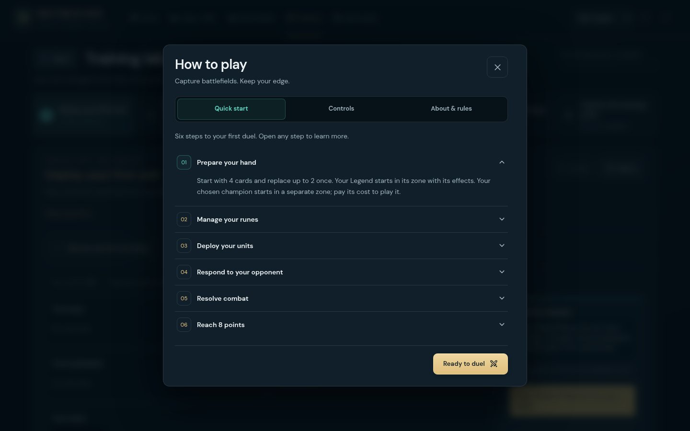
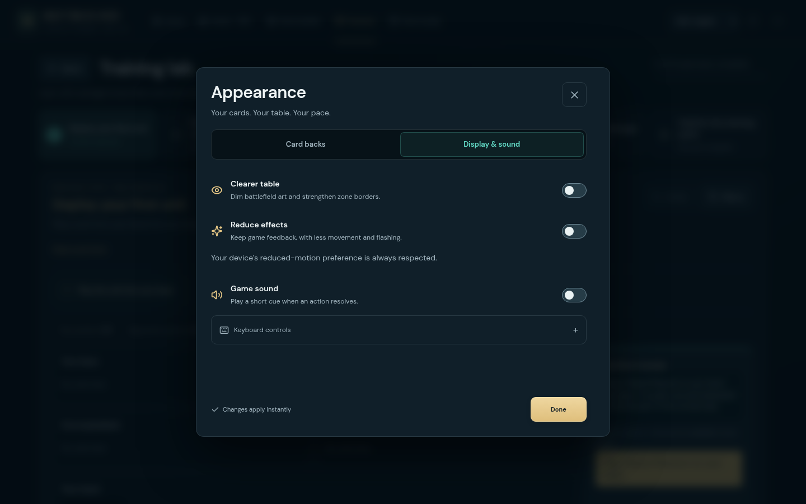
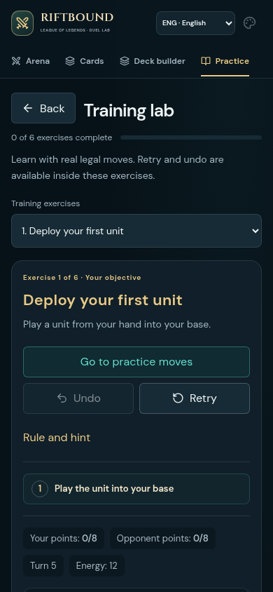

# Support UI polish — 20 October 2026

This pass reviews the main desktop and mobile routes and improves help, appearance settings and training. It follows the table and card cleanup in the preceding releases.

## Reviewed flows

1. **Arena and setup.** Fresh desktop and mobile captures confirmed that the selected matchup and launch controls remain readable. No additional layout change was needed.
2. **Card library.** Search, filters, empty results, pagination, language persistence and keyboard focus recovery passed the existing interaction checks.
3. **Deck builder.** Quantity changes, Undo, save/import and actual text/file exports passed at 1440, 390 and 320 pixels.
4. **Practice.** The six large lesson tiles delayed the objective on phones. A native lesson selector now replaces that gallery on narrow screens. Desktop uses one row, with two readable rows on smaller laptops. Shorter Undo/Retry labels keep their full accessible names. Reopening Practice starts at the first unfinished lesson; all six exercises remain freely selectable.
5. **Help.** The original long introduction put rules, controls and references in one scrolling document. Three keyboard-accessible tabs now separate Quick start, Controls and About & rules. Native disclosures expose each of the six steps. The title, close control and Ready action remain available while the content scrolls.
6. **Appearance.** Display and sound switches previously followed the card-back gallery. They now have their own tab alongside Card backs. Existing artwork, immediate preference updates and save-failure feedback remain available.
7. **Match table and card inspection.** The crowded table, movement, combat, reactions and Hidden-card flows passed. Desktop hover still shows one large artwork image. Mobile retains clean card faces and long-press reading without selecting or playing the card.
8. **Menus, history and saved play.** Mobile settings, Help, piles, saved sessions and replay navigation passed at portrait and landscape sizes, including focus return and preservation of the selected move.

## Final captures

These images were captured from production build `39bf6c26f5a5`, after fonts and visible artwork loaded.

## Validation

- TypeScript, Vite and the server build passed.
- The required local regression selection passed **1,006 tests in 80 files**. The saved-game selection passed **14 tests**, with seven unrelated cases intentionally excluded by the existing workflow filter.
- Catalog consistency and all 15 regression-report guards passed.
- Production-preview checks passed all **10 appearance scenarios** and **five support-navigation viewport scenarios**, including all three interface languages, arrow/Home/End tab navigation, focus containment/return, hidden-panel exclusion, persistent actions, preference reload and training resume.
- Existing Chromium checks passed **21 support scenarios**, **15 desktop table scenarios**, mobile overlay flows at three sizes and real Chromium touch gestures for card inspection.
- New copy is translated into English, Serbian and Italian. The touch instruction uses a distinct translation key so the game's “Hold” scoring term retains its original meaning.

The new regression entry point is `scripts/support-polish-check.mjs`. Appearance checks now explicitly choose the settings tab and move the pointer away from table cards before checking automatic play resumption; inspecting a card intentionally pauses play. The mobile menu test follows the shared dialog manager's initial heading focus.

The browser checks use isolated Chromium sessions and emulated mobile viewports, not physical phones. They cover the named flows rather than every card interaction or full accessibility conformance. This pass does not alter game rules, AI or online-room infrastructure.
